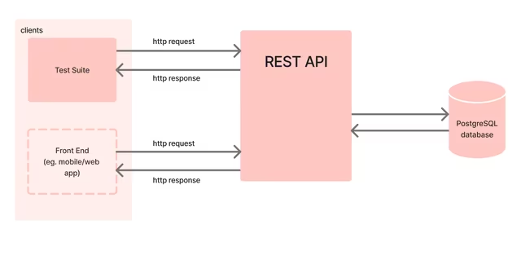

# NC Plus One

A Python/PostgreSQL backend for managing events. Users can register, browse
events and RSVP; organisers can create events at venues and (planned) view
statistics about their audience.

> This is a backend-only project. There is no frontend.

## Project architecture



## Status

- [x] Database schema (users, venues, events, rsvps)
- [x] Seed data and seeding scripts
- [x] Data utilities, built with TDD (email normalisation, password hashing)
- [ ] API endpoints (register, browse events, RSVP, manage attendance)
- [ ] Organiser features (create/manage events, audience statistics)

## Tech

- Python 3, PostgreSQL
- psycopg2, python-dotenv, bcrypt
- pytest, mypy

## Setup

1. Create and activate a virtual environment, then install dependencies:

   ```bash
   python -m venv venv
   source venv/bin/activate
   pip install -r requirements.txt
   ```

2. Create the database:

   ```bash
   createdb nc_plus_one
   ```

3. Create your environment file from the template, then edit the values:

   ```bash
   cp .env.example .env.development
   ```

   | Variable     | Meaning                     |
   |--------------|-----------------------------|
   | `PGDATABASE` | Name of the database        |
   | `PGUSER`     | PostgreSQL username         |
   | `PGPASSWORD` | PostgreSQL password         |
   | `PGHOST`     | Database host (`localhost`) |

   `.env.development` is git-ignored; `.env.example` is committed.

## Seeding the database

From the project root:

```bash
python main.py
```

This drops and recreates all tables, then loads `db/data/*.json`.
**It is destructive:** existing data is wiped.

The seeding is split into small functions in `src/seed.py`:

| Function | Responsibility |
|----------|----------------|
| `drop_tables` | Runs `db/drop_tables.sql` (children first) |
| `create_tables` | Runs `db/create_tables.sql` (parents first) |
| `seed_users_table` | Inserts users (emails normalised, passwords hashed) |
| `seed_venues_table` | Inserts venues |
| `seed_events_table` | Inserts events |
| `seed_rsvp_table` | Inserts RSVPs |
| `seed` | Runs all of the above in foreign-key order, rolling back on error |

Seed passwords in the JSON are plain-text dummy values; they are hashed with
bcrypt before being stored.

## Utilities

`src/utils.py` holds functions that transform data before insertion. Each was
built test-first (TDD):

- `normalise_email`: trims whitespace and lowercases
- `hash_password`: returns a salted bcrypt hash

## Testing

```bash
pytest
```

Type checking:

```bash
mypy main.py src config
```

## Checking the data

```bash
psql nc_plus_one
```

```sql
\dt
SELECT email, password FROM users LIMIT 2;
```

## Project structure

```
main.py                 entry point: load JSON, rebuild and seed
config/connection.py    database connection
db/drop_tables.sql      drops tables
db/create_tables.sql    creates tables
db/data/                seed data (JSON)
src/seed.py             seeding functions
src/utils.py            data utilities (TDD)
tests/                  pytest tests
.env.example            environment variable template
```

## Schema

| Table  | Columns |
|--------|---------|
| users  | user_id, email, password (bcrypt hash), name, created_at |
| venues | venue_id, name, address, capacity |
| events | event_id, title, description, starts_at, ends_at, organiser_id → users, venue_id → venues, created_at |
| rsvps  | rsvp_id, attendee_id → users, event_id → events, created_at |